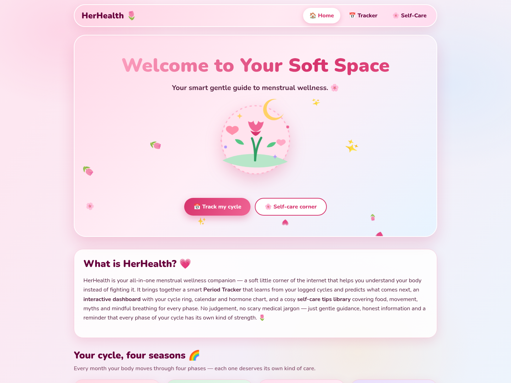
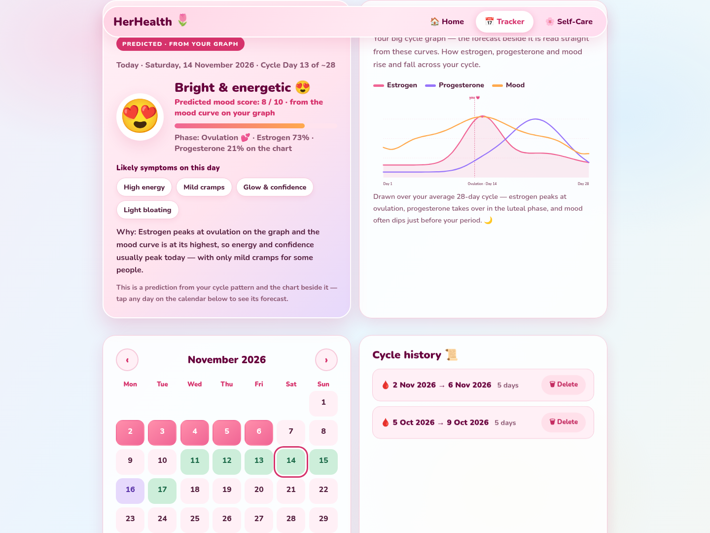
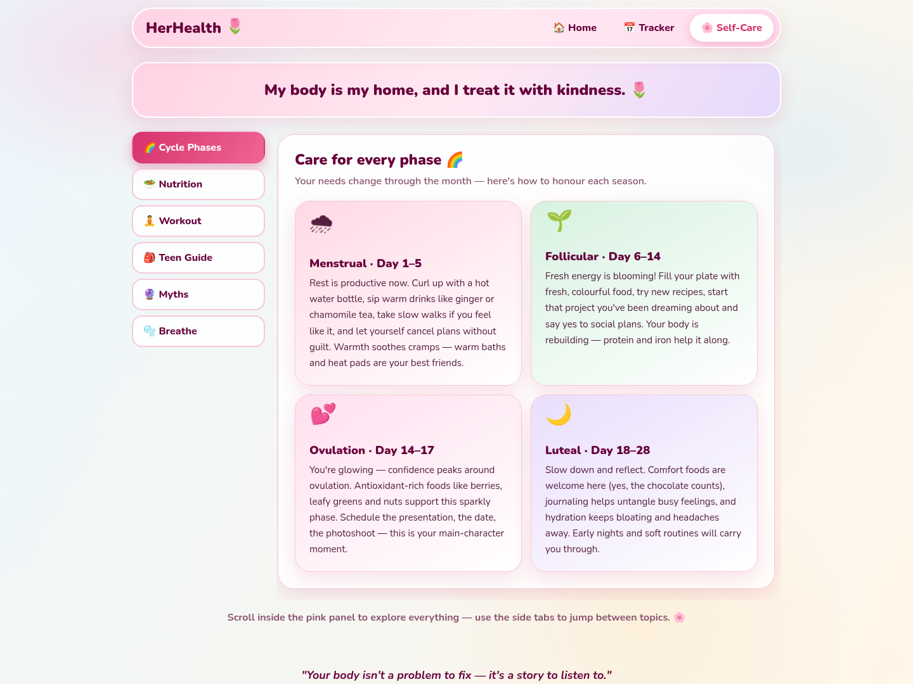

# 🌷 HerHealth

**A soft little corner of the internet that helps you understand your cycle — not fight it.**



*HerHealth is a friendly website that helps girls and women track their periods, moods and symptoms with a smart tracker and dashboard — plus self-care tips that support your physical and emotional well-being, making your menstrual journey easier, more understood, and beautifully cared for.*

---

## 📸 The project

I built HerHealth because period apps either feel like medical charts or ask you to log a hundred things every day. Here you just log your period dates — HerHealth learns your rhythm from your own cycles and does the predicting for you.

|  |  |
| --- | --- |
| *Today's forecast & the big hormone graph — calendar and history side by side* | *Self-care for every phase, in one scrollable panel* |

## ✨ What it does

- 🩸 **Log a cycle in seconds** — just the start and end dates; that's all HerHealth needs
- 💍 **Cycle ring & live stats** — your cycle day, phase, next period, average cycle and period length, always up to date
- 🔮 **Today's forecast, predicted for you** — no mood or symptom logging, ever. HerHealth reads your hormone graph and predicts your mood, a mood score out of 10, and the symptoms you're likely to feel that day — with a plain-language *why*
- 📈 **Big Hormones & mood chart** — estrogen, progesterone and mood curves across your whole cycle, drawn from *your* average cycle length
- 📅 **Calendar + cycle history side by side** — period days, predicted days, fertile window and ovulation at a glance; tap any day to see its forecast
- 🌈 **Self-care library** — cycle phases, nutrition, workout, a teen guide, myth-busting flip cards and a guided breathing exercise, all in one scrollable panel with side tabs
- 🌸 **Gentle touches** — a daily tip, rotating affirmations and falling petals, because tracking your health shouldn't feel clinical
- 🔒 **Private by design** — everything is saved only in your own browser (localStorage). No account, no sign-up, nothing leaves your device

## 🧠 How the forecast works

Your estrogen and progesterone rise and fall in a pattern across the cycle — and mood usually follows them. HerHealth models those curves over your average cycle, finds where *today* (or any day you tap) sits on them, and turns that into a mood prediction, likely symptoms and a short explanation. Estrogen peaking? Probably bright and energetic. Late luteal dip? Probably tired, with bloating and cravings — and that's completely normal.

## 🗂️ Project structure

| File / Folder | What's inside |
| --- | --- |
| `index.html` | The whole app — Home, Tracker and Self-Care in one file |
| `tracker.html` · `selfcare.html` | Tiny redirect pages that open the app |
| `pics/` | README screenshots |

## 🚀 Live demo

**[▶ Try HerHealth live](https://herhealth-roan.vercel.app)** — no sign-up, just log your first cycle and watch it learn.

## 💻 Run it locally

No build step, no dependencies — it's a static site.

```
git clone https://github.com/NidhiSaini27/HerHealth.git
cd HerHealth
```

Then open `index.html` in your browser — or serve it with any static server, e.g. `npx serve .`

## 💡 Ideas for v2

- Gentle reminders before your predicted period
- Exporting your cycle history as a PDF for doctor visits
- More languages, starting with Hindi
